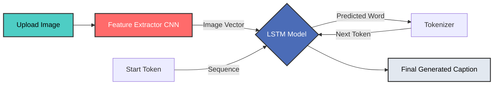

<div align="center">
  
  
  
  

  <h1>✨ PixelPoet AI ✨</h1>
  <p>An AI model that instantly creates engaging captions for your images, making every post social-ready.</p>
</div>

---

## 🚀 Overview

**PixelPoet AI** bridges the gap between Computer Vision and Natural Language Processing. By leveraging a Convolutional Neural Network (CNN) for image feature extraction and a Long Short-Term Memory (LSTM) network for sequence generation, this application "looks" at an image and intelligently writes a caption describing its contents.

We've completely overhauled this project to feature a **premium glassmorphic Streamlit UI**, ultra-fast dependency management using **`uv`**, and optimized model-caching for real-time inference.

---

## 🌟 Key Features

- **🧠 Custom CNN-LSTM Architecture:** Trained on the Flickr8k dataset, utilizing a powerful image feature extractor paired with an LSTM sequence model.
- **⚡ Blazing Fast Setup:** Powered by `uv`, the Rust-based Python package manager. Dependencies resolve and install in seconds using the global cache.
- **🎨 Premium UI/UX:** A gorgeous, responsive Streamlit interface featuring dark mode, glassmorphic containers, micro-animations, and dynamic gradient text.
- **🚀 Memory Optimized:** Utilizes `@st.cache_resource` to load heavy deep learning `.keras` models into RAM only once, dropping inference time drastically.
- **📊 Tensor Visualization:** Automatically renders the processed image tensor via `matplotlib` inside an interactive expander for deep-dive analysis.

---

## 🏗️ Architecture



---

## 🛠️ Setup & Installation

This project uses **`uv`**, an extremely fast Python package and project manager. 

### 1. Install `uv` (if not already installed)
```bash
# macOS and Linux
curl -LsSf https://astral.sh/uv/install.sh | sh

# Windows (PowerShell)
powershell -ExecutionPolicy ByPass -c "irm https://astral.sh/uv/install.ps1 | iex"
```

### 2. Clone the Repository
```bash
git clone https://github.com/AffanZulfiqar/PixelPoet-AI.git
cd PixelPoet-AI
```

### 3. Install Dependencies Instantly
Because we use `uv`, you don't need to manually create a virtual environment. Just run:
```bash
uv sync
```
*(Tip: Deep Learning libraries work best on Python 3.10. If you have a newer version and run into issues, force Python 3.10 by running `uv python pin 3.10` before syncing).*

### 4. Download the Pre-trained Models
Because the deep learning models are very large, they are not stored directly in the repository. 
1. Go to the **Releases** tab on the right side of this GitHub repository.
2. Download the trained model files.
3. Place them inside the `models/` directory in the root of the project. Make sure the folder contains:
   - `model.keras`
   - `feature_extractor.keras`
   - `tokenizer.pkl`

---

## 💻 Usage

Start the Streamlit application using `uv`:

```bash
uv run streamlit run main.py
```

1. Open the local URL provided in your terminal (usually `http://localhost:8501`).
2. Drag and drop an image (`.jpg`, `.png`) into the upload zone on the left.
3. Click **Generate Caption 🚀**.
4. Read the generated insight and explore the processed tensor visualization!

---

## 📂 Project Structure

```text
📦 PixelPoet-AI
 ┣ 📂 models/                 # Deep Learning Models
 ┃ ┣ 📜 model.keras           # The trained LSTM captioning model
 ┃ ┣ 📜 feature_extractor.keras # The CNN feature extractor
 ┃ ┗ 📜 tokenizer.pkl         # Tokenizer for text sequences
 ┣ 📜 main.py                 # Advanced Streamlit Application Entrypoint
 ┣ 📜 pyproject.toml          # uv Dependency and Project configuration
 ┣ 📜 model_training.ipynb    # Training Notebook
 ┗ 📜 README.md               # Project Documentation
```

---

